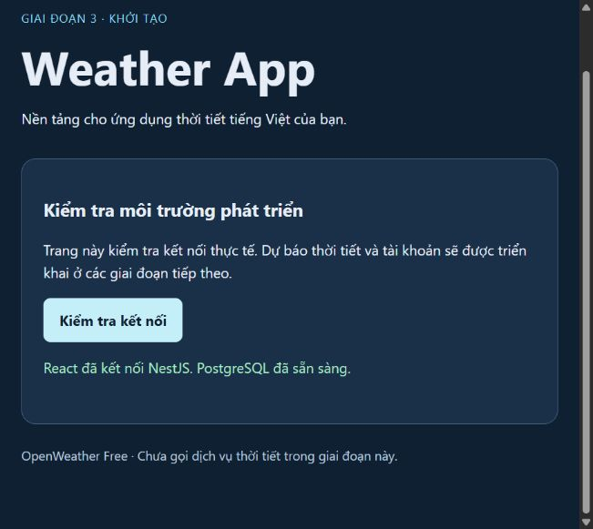

# Weather App

Ứng dụng thời tiết tiếng Việt dùng React/JavaScript, NestJS/TypeScript, Prisma và PostgreSQL, phát triển theo từng giai đoạn để học và làm portfolio.

**Trạng thái ngày 25/10/2026: hoàn thành backend Giai đoạn 4.** API đã có xác thực, hồ sơ, yêu thích, lịch sử và thời tiết OpenWeather thật. Frontend vẫn là trang kiểm tra kết nối Giai đoạn 3; dashboard và các màn hình nghiệp vụ thuộc Giai đoạn 5. Không có số liệu thời tiết demo.



## Những gì đã có

- Frontend React + Vite + React Router, JavaScript/JSX, trang kiểm tra kết nối tiếng Việt và route không tồn tại.
- Backend NestJS chia Auth/Users/Weather/Favorites/SearchHistory/Health; Swagger cho 21 thao tác, DTO validation, envelope thống nhất, Helmet, giới hạn body và rate limiting.
- Đăng ký/đăng nhập/refresh/logout, hồ sơ, đổi mật khẩu; Argon2id, JWT 15 phút, session PostgreSQL tối đa 7 ngày, cookie HttpOnly và CSRF gắn phiên.
- OpenWeather Free: tìm địa điểm, thời tiết hiện tại, dự báo 5 ngày/mốc 3 giờ, cache và timeout. Cảnh báo trả `UNSUPPORTED`.
- Yêu thích tối đa 50, lịch sử tối đa 20/tài khoản, chống trùng và kiểm tra quyền sở hữu. Đã áp dụng migration bốn bảng với khóa ngoại, unique, index và CHECK tọa độ.
- PostgreSQL 18 chạy trong cluster riêng `.local/postgres` trên cổng 55432; tài khoản ứng dụng không có quyền superuser/createdb/createrole.
- ESLint, Prettier, package-lock, kiểm tra cấu hình môi trường; 38 unit/HTTP test và 12 integration test PostgreSQL thật đã đạt.

## Phiên bản đã chạy

| Công nghệ | Phiên bản |
| --- | --- |
| Node.js / npm | 24.21.0 / 11.19.0 |
| PowerShell / PostgreSQL | 7.6.5 / 18.6 |
| React / React DOM | 19.3.1 |
| Vite / React Router | 8.3.5 / 7.18.4 |
| NestJS / TypeScript | 12.2.0 / 6.0.3 |
| Prisma CLI / Client / adapter-pg | 7.10.1 |
| ESLint / Prettier / Vitest | 10.13.0 / 3.9.10 / 5.0.5 |
| jose / argon2 / cookie | 6.2.13 / 0.45.1 / 2.0.1 |

Người dùng đã đồng ý dùng PostgreSQL 18 có sẵn thay cho 17 trong thiết kế ban đầu. Node 24.21.0 đáp ứng dependency, nhưng cần cập nhật bản vá LTS trước public launch. Docker chưa được cài/kiểm chứng; Compose đầy đủ thuộc Giai đoạn 7.

## Chạy local trên Windows

Yêu cầu Node 24 LTS (>=24.15), npm 11, **PowerShell 7.4 trở lên** và bộ binary PostgreSQL 18. Các công cụ này đã được kiểm tra trên máy hiện tại; máy khác cần cài từ nhà cung cấp chính thức trước. Script không cài dịch vụ Windows và không tác động cluster mặc định cổng 5432.

### 1. Khởi động database riêng

Mở PowerShell 7 tại repository:

```powershell
Set-Location 'C:\FullStack-Learning\weatherApp'
pwsh -File .\scripts\start-local-db.ps1
```

Lần đầu, script tạo cluster, mật khẩu ngẫu nhiên, role `weather_app`, database `weather_app` và `.env` ở gốc. **Không copy `.env.example` trước khi dùng script tự tạo này.** Lần sau script khởi động lại cluster và giữ nguyên dữ liệu/thông tin đăng nhập. PostgreSQL cài ở chỗ khác thì truyền `-PgBin 'D:\PostgreSQL\18\bin'`.

Trên máy hiện tại database và `.env` đã tạo, không cần tạo lại. `.local/` và `.env` được Git ignore; không chia sẻ hoặc commit nội dung. Backup `.local/postgres` theo quy trình PostgreSQL nếu cần giữ dữ liệu về sau; đừng xóa thư mục để xử lý lỗi tùy tiện.

Nếu tự quản lý PostgreSQL thay vì script, tạo role/database riêng rồi copy `.env.example` thành `.env` và đặt DATABASE_URL đúng. Mật khẩu có ký tự đặc biệt phải URL-encode. Khi `.env` đã tồn tại nhưng không có thông tin cluster local, script cố ý dừng để tránh ghi đè cấu hình.

### 2. Cài dependency từ lockfile (máy mới hoặc sau khi dependency thay đổi)

```powershell
npm --prefix .\backend ci
npm --prefix .\frontend ci
```

Máy hiện tại đã được cài. Không dùng `npm audit fix --force`; kiểm tra ảnh hưởng trước mỗi nâng cấp. Backend cho phép script cài đặt Prisma và Argon2 đã duyệt, chặn script telemetry Scarf.

Khởi tạo secret và áp dụng migration sau khi cài backend:

```powershell
node .\scripts\init-auth-secrets.mjs
npm --prefix .\backend run migrate:deploy
```

Script chỉ sinh JWT_SECRET/CSRF_SECRET còn trống, không thay secret đã có. Điền `OPENWEATHER_API_KEY` vào **`.env`**, không vào `.env.example`, rồi khởi động lại backend. Không gửi key vào chat. Trên máy hiện tại các bước này đã hoàn tất và key Free đã gọi thành công ba endpoint.

### 3. Chạy backend và frontend ở hai terminal

Terminal A, tại gốc repository:

```powershell
npm --prefix .\backend run dev
```

Terminal B, cùng thư mục:

```powershell
npm --prefix .\frontend run dev
```

- Giao diện: [http://127.0.0.1:5173](http://127.0.0.1:5173).
- Swagger cùng origin: [http://127.0.0.1:5173/api/docs/](http://127.0.0.1:5173/api/docs/). Khi thử mutation, dùng trang này để Origin khớp APP_ORIGIN; lấy CSRF qua `/auth/csrf`, copy `data.csrfToken` vào header của thao tác cần chạy. Sau login/refresh dùng CSRF mới trả về.
- Nhấn **Kiểm tra kết nối**; kết quả mong đợi: “React đã kết nối NestJS. PostgreSQL đã sẵn sàng.”

Backend đọc `.env` ở gốc. Vite proxy `/api` theo BACKEND_URL; không đưa DATABASE_URL hoặc secret vào biến `VITE_*`. JWT/CSRF secret bắt buộc ở mọi môi trường. Local thiếu OpenWeather key vẫn chạy auth/health, nhưng weather trả 503; production yêu cầu cả key và APP_ORIGIN HTTPS. Chưa triển khai public hoặc cấu hình cloud/Docker.

Ctrl+C trong mỗi terminal dừng server tương ứng. Dừng database riêng khi không dùng:

```powershell
pwsh -File .\scripts\stop-local-db.ps1
```

### 4. Kiểm tra chất lượng

```powershell
npm --prefix .\backend run lint
npm --prefix .\backend run format:check
npm --prefix .\backend test
npm --prefix .\backend run test:integration
npm --prefix .\backend run prisma:validate
npm --prefix .\backend run db:check
npm --prefix .\frontend run lint
npm --prefix .\frontend run format:check
npm --prefix .\frontend run build
```

`backend test` tự build rồi chạy 38 test, mock OpenWeather và DB khi phù hợp. `test:integration` tự tạo database **weather_app_test** trên cluster riêng cổng 55432, áp dụng migration, chạy 12 test và xóa user test do chính lượt chạy tạo; không dùng database ứng dụng. Runner này chỉ hỗ trợ thiết lập local bằng script hiện có. `db:check` chỉ SELECT 1. Chưa có bộ test frontend tự động; phần đó thuộc Giai đoạn 5.

Kiểm tra tùy chọn với OpenWeather thật (tốn 3 request Free; không tự chạy trong unit test):

```powershell
npm --prefix .\backend run test:weather-live
```

Kiểm tra API qua proxy:

```powershell
Invoke-RestMethod 'http://127.0.0.1:5173/api/v1/health/live'
Invoke-RestMethod 'http://127.0.0.1:5173/api/v1/health/ready'
```

Khi PostgreSQL ngừng chạy: live vẫn 200, ready trả 503 với `DATABASE_UNAVAILABLE`; frontend hiển thị lỗi và cho thử lại. Khởi động lại database rồi kiểm tra phải phục hồi 200.

## Phạm vi sản phẩm đã chốt

OpenWeather **Free**: thời tiết hiện tại, tìm kiếm geocoding và dự báo 5 ngày theo mốc 3 giờ. Backend đã triển khai phạm vi này; key đã xác minh ngày 25/10/2026. Dự báo có thể chạm 6 ngày lịch với ngày đầu/cuối thiếu mốc. Khách được đọc weather API; người đăng nhập có dữ liệu riêng và tùy chọn C/F. API luôn trả Celsius gốc; chuyển đổi đồng bộ trên giao diện sẽ làm ở Giai đoạn 5. Cảnh báo trả nguồn chưa hỗ trợ, không giả là “không có cảnh báo”.

## Tài liệu và bước tiếp theo

- [Báo cáo Giai đoạn 3, lỗi thường gặp và bằng chứng kiểm tra](docs/phase-3.md).
- [Báo cáo Giai đoạn 4, lệnh kiểm thử và giới hạn](docs/phase-4.md).
- [Kiến trúc và ERD](docs/architecture.md).
- [API contract](docs/api-contract.md) — request/response, CSRF, pagination và lỗi.
- [Wireframe và quy tắc giao diện](docs/ui-design.md) — dashboard thuộc Giai đoạn 5.

Git local dùng `main`, `develop`, `feature/*`; backend ở `feature/backend`, kế thừa `feature/project-setup`. Chưa tạo GitHub remote hoặc push. Giai đoạn 5 tiếp theo: dashboard tiếng Việt và tích hợp các luồng tài khoản/thời tiết. Docker, hướng dẫn cloud và CONTRIBUTING đầy đủ sẽ hoàn thiện ở Giai đoạn 7.
