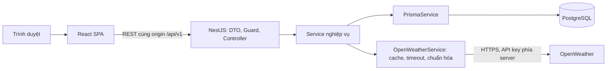
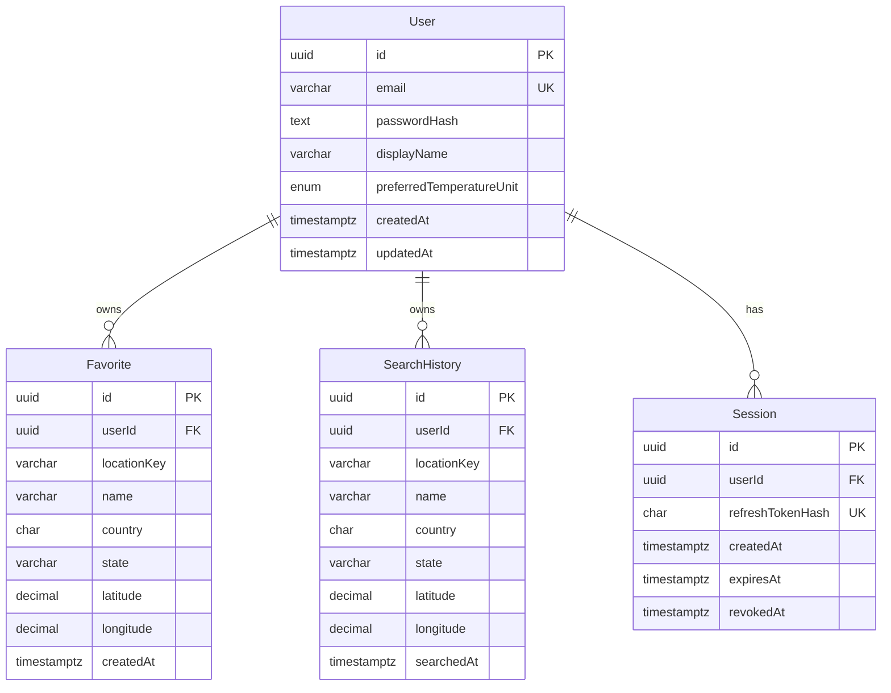

# Thiết kế kiến trúc và dữ liệu

Ngày: 24/10/2026. Trạng thái: thiết kế Giai đoạn 2; chưa triển khai. Phạm vi và các mặc định đã được người dùng xác nhận trong chat. Chi tiết kỹ thuật dưới đây là baseline cho triển khai.

## 1. Phạm vi và quyết định kiến trúc

| Quyết định | Lý do | Hệ quả / phương án chưa chọn |
| --- | --- | --- |
| Một repository, React SPA và NestJS chia module | Dễ học, kiểm thử và triển khai từng phần | Chưa cần microservices hoặc monorepo build framework |
| OpenWeather Free | Phù hợp ngân sách và phạm vi đã chốt | Không có dự báo từng giờ, 7 ngày hay cảnh báo thật; không tự đăng ký trả phí |
| Cùng origin qua proxy `/api` | Đơn giản hóa cookie và CORS | Cloud cần reverse proxy tương ứng; tách origin phải thiết kế lại trước |
| JWT + Session trong PostgreSQL | JWT có thời hạn, phiên có thể thu hồi | Guard cần DB cho request riêng tư; không tuyên bố JWT hoàn toàn stateless |
| Refresh token ngẫu nhiên, xoay vòng | Giảm khả năng dùng lại token đã tiêu thụ | Cần cập nhật nguyên tử và xử lý refresh đồng thời |
| Cache bộ nhớ trong một backend instance | Ít thành phần vận hành | Mất khi restart; phải thay bằng kho dùng chung khi chạy nhiều instance |
| Không lưu thời tiết vào PostgreSQL | Không có nghiệp vụ lưu trữ thời tiết lịch sử | SearchHistory chỉ chứa địa điểm, không chứa snapshot thời tiết |

Ngoài MVP: quên mật khẩu, xác minh email, OAuth, quản trị, thông báo đẩy, định vị thiết bị, dịch tự động cảnh báo. Không có endpoint xóa tài khoản trong MVP; cascade quy định tính toàn vẹn khi xóa user bằng quy trình quản trị sau này.

## 2. Phiên bản định hướng

| Thành phần | Dòng phiên bản |
| --- | --- |
| Node.js | 24 LTS; đề xuất cập nhật 24.22.1 |
| npm | 11.x |
| React / React DOM | 19.3.x, cùng phiên bản |
| Vite / React Router | 8.x / 7.x (SPA declarative mode) |
| NestJS / TypeScript backend | 12.x / 6.x, ESM |
| Prisma CLI / Client / PostgreSQL adapter | 7.x, khóa đồng bộ |
| PostgreSQL | 17.x |
| Docker Compose | v2 |

Chưa khóa patch hoặc xác minh build. Giai đoạn 3 kiểm tra registry/peer dependencies, dùng ESLint và Prettier theo yêu cầu dù scaffold có thể dùng công cụ khác; ghi phiên bản chính xác vào package-lock của từng ứng dụng. Frontend không đổi sang TypeScript.

Nguồn đã đọc Giai đoạn 1: [Node LTS](https://nodejs.org/en/blog/release/v24.22.1), [Vite](https://vite.dev/guide/), [Nest migration](https://docs.nestjs.com/migration-guide), [React](https://react.dev/versions), [Router 7](https://reactrouter.com/7.9.6/upgrading/v6), [Prisma 7 requirements](https://www.prisma.io/docs/orm/v7/reference/system-requirements), [database hỗ trợ](https://www.prisma.io/docs/orm/v7/reference/supported-databases). Phiên bản phải được kiểm tra lại lúc cài, không lấy `latest` tùy tiện.

## 3. Module và luồng dữ liệu



| Module id | Trách nhiệm | Phụ thuộc |
| --- | --- | --- |
| users | Đọc/sửa hồ sơ, đổi mật khẩu và thu hồi phiên liên quan | Auth, Prisma |
| auth | Đăng ký, login, JWT, Session, refresh, CSRF và guard | Prisma |
| weather | Search/current/forecast/alerts capability | OpenWeatherService |
| favorites | Yêu thích theo owner | Auth, Prisma |
| search-history | Lịch sử theo owner và giới hạn lưu | Auth, Prisma |
| health | Liveness và readiness database | Prisma |

AuthModule không import UsersModule: AuthService dùng Prisma để đăng ký/đọc thông tin đăng nhập. Auth export guard, PasswordService (hash/verify) và SessionService. UsersModule import Auth để bảo vệ hồ sơ, dùng lại PasswordService/SessionService khi đổi mật khẩu; SessionService nhận Prisma transaction client để thu hồi phiên trong cùng transaction cập nhật hash. Không có vòng import hoặc module lắp ghép bổ sung chỉ để né vòng phụ thuộc.

Thứ tự xây: nền tảng Prisma/config và schema User → Auth → Users API; Weather độc lập → Favorites/History → Frontend tích hợp.

GET weather không có tác dụng ghi DB. POST history chỉ gọi sau hành động chọn địa điểm (kể cả từ favorites/history), không ghi từng ký tự tìm kiếm hoặc mỗi lần refresh thời tiết. Đổi °C/°F không gọi lại OpenWeather.

## 4. Cấu trúc thư mục dự kiến

Chỉ các file Markdown bàn giao hiện tồn tại. Cây sau là mục tiêu, không phải danh sách đã tạo:

```text
weatherApp/
├── frontend/
│   ├── src/
│   │   ├── app/             # Router, AuthProvider, TemperatureProvider
│   │   ├── pages/           # Dashboard, Login, Register, Account, NotFound
│   │   ├── features/        # weather, search, auth, favorites, history
│   │   ├── components/      # Button, Field, EmptyState, ErrorNotice
│   │   ├── lib/             # api.js, temperature.js, date-time.js
│   │   └── styles/          # tokens.css, global.css; component dùng modules
│   ├── e2e/
│   ├── package.json
│   └── package-lock.json
├── backend/
│   ├── src/
│   │   ├── main.ts
│   │   ├── app.module.ts
│   │   ├── common/          # filter, interceptor, config validation
│   │   ├── prisma/          # PrismaModule, PrismaService
│   │   └── modules/         # auth, users, weather, favorites, search-history, health
│   ├── prisma/              # schema.prisma, migrations/
│   ├── test/                # API/integration trên DB kiểm thử riêng
│   ├── prisma.config.ts
│   ├── package.json
│   └── package-lock.json
├── docs/
├── .env.example
├── .gitignore
├── docker-compose.yml
├── README.md
└── CONTRIBUTING.md
```

Unit test đặt cạnh service/component. Không thêm generic repository bọc Prisma hoặc chia mọi component nhỏ thành một feature. Các file env thật, node_modules, dist, coverage và artifacts test chứa dữ liệu cá nhân phải được ignore trước khi cài/chạy.

## 5. Database và ERD



### Kiểu dữ liệu và ràng buộc

- UUID do backend/Prisma sinh. Thời gian `Timestamptz(3)`; API trả ISO 8601 UTC.
- User.email: `VarChar(254)`, trim và lowercase trước lưu, unique. Chính sách ứng dụng coi email không phân biệt hoa thường; không xử lý riêng dấu chấm hoặc `+tag` theo nhà cung cấp.
- User.displayName: `VarChar(80)`, trim, dài 1–80. passwordHash: Text, Argon2id; enum đơn vị `C | F`, mặc định `C`. `updatedAt` do Prisma quản lý.
- Favorite và SearchHistory: name `VarChar(160)`; country `Char(2)` uppercase; state `VarChar(160)` nullable; latitude `Decimal(7,4)`; longitude `Decimal(7,4)`; locationKey `VarChar(64)`.
- `state` và `revokedAt` là nullable; các trường còn lại trong ERD bắt buộc.
- Khóa unique `(userId, locationKey)` trên cả Favorite và SearchHistory. Index `(userId, createdAt, id)` trên Favorite, `(userId, searchedAt, id)` trên SearchHistory.
- Session.refreshTokenHash: SHA-256 của token ngẫu nhiên 256 bit, hex 64 ký tự. Khác mật khẩu con người, token có entropy cao nên không cần Argon2. Index `(userId, revokedAt)` và `expiresAt` để tìm/thu hồi/dọn phiên.
- FK userId `ON DELETE CASCADE` cho cả ba bảng phụ thuộc. Không trả FK hoặc hash/session secrets trong API DTO công khai.
- Migration thêm CHECK latitude trong [-90,90], longitude [-180,180], country dạng `[A-Z]{2}`; DTO vẫn validate trước. Không áp giới hạn số lượng hàng bằng CHECK vì cần transaction nhiều hàng.

### Định danh địa điểm

Direct Geocoding không cung cấp ID hành chính ổn định trong contract sử dụng. MVP định nghĩa cùng địa điểm là **cùng ô tọa độ 4 chữ số thập phân** (~11 m theo vĩ độ), không phải cùng tên thành phố.

Backend kiểm tra số hữu hạn/range, làm tròn tọa độ đến 4 chữ số, chuẩn hóa `-0` thành `0`, tạo `ow:{lat.toFixed(4)}:{lon.toFixed(4)}`. Cache, query thời tiết, DTO location và DB dùng cùng hàm chuẩn hóa. Frontend không gửi locationKey cho POST; backend tự sinh. Country/name không nằm trong khóa để cùng tọa độ với tên bản địa khác vẫn chống trùng.

Giới hạn: provider đổi centroid hoặc hai kết quả khác tọa độ cho cùng thành phố vẫn có thể thành hai địa điểm. Tên/state/country do client gửi là metadata không đáng tin: giới hạn độ dài, render text, không dùng để phân quyền hoặc gọi URL. Không tuyên bố các địa điểm do người dùng lưu đã được chứng thực hành chính.

### Transaction và lưu trữ

- Favorite: khóa hàng User theo userId trong transaction; kiểm tra trùng trước giới hạn; trùng trả 409; đủ 50 trả 409; insert. Unique DB là lớp bảo vệ cuối. Các thao tác tạo/xóa danh sách cùng user dùng cùng khóa.
- History: khóa User, upsert `(userId, locationKey)`, cập nhật metadata/searchedAt, xóa phần ngoài 20 mới nhất theo `searchedAt DESC, id DESC`, commit. Xóa từng mục/toàn bộ cũng dùng khóa này để thứ tự cạnh tranh xác định.
- Login và đổi mật khẩu phối hợp khóa User; login không tạo phiên từ passwordHash cũ sau khi đổi mật khẩu đã commit. Nếu hash kiểm tra ngoài transaction, phải kiểm tra hash chưa đổi trong transaction trước tạo Session.
- Đổi mật khẩu: cập nhật hash + thu hồi tất cả Session trong một transaction; yêu cầu đăng nhập lại.
- Phiên hết hạn/thu hồi được dọn định kỳ; giới hạn tối đa 5 phiên hoạt động/user, login mới thu hồi phiên cũ nhất khi vượt. Dọn session revoked ngay hoặc trong vòng 24 giờ, không cần giữ IP/user-agent vì chưa có nghiệp vụ sử dụng.
- Truy vấn xóa theo `{ id, userId }`; không tìm bằng id rồi tin rằng đã kiểm tra quyền ở frontend. Không có/không thuộc owner đều 404.
- Không chạy migration trong Giai đoạn 2. Giai đoạn 3 cấu hình DB; Giai đoạn 4 dùng Prisma Migrate và kiểm tra migration trên DB trống trước triển khai.

## 6. Luồng xác thực và CSRF

1. GET `/auth/csrf` cung cấp token chống CSRF trong JSON. Trước login, token gắn với nonce ngẫu nhiên trong cookie HttpOnly ký HMAC, hạn 1 giờ. Sau login, token gắn Session.id; endpoint có thể nhận diện phiên qua refresh cookie còn hợp lệ khi access đã hết hạn.
2. POST register/login yêu cầu đúng Origin + CSRF header + JSON. Register thành công đồng thời tạo phiên. Password dài 12–128 ký tự, không trim/normalize mật khẩu; không ép quy tắc ký tự tùy tiện. Argon2id tối thiểu memory 19 MiB, iterations 2, parallelism 1; benchmark khi triển khai.
3. Server đặt access JWT (HS256, secret mạnh riêng, kiểm tra algorithm/iss/aud/sub/sid/exp) 15 phút và opaque refresh token 7 ngày. Session có thời hạn tuyệt đối 7 ngày từ login, refresh không kéo dài vô hạn; access không vượt hạn phiên.
4. AuthResult trả user và CSRF token mới gắn phiên; **không trả JWT hoặc refresh token trong JSON**. Xóa cookie nonce ẩn danh cũ. Frontend giữ CSRF trong bộ nhớ.
5. Guard kiểm tra JWT và Session chưa revoked/chưa hết hạn, Session.userId = JWT.sub. Không cache trạng thái Session trong MVP. Nếu DB lỗi, trả 503, không cho qua và không coi là sai mật khẩu.
6. Chỉ lỗi 401 `ACCESS_EXPIRED`/`AUTH_REQUIRED` mới cho frontend thử refresh một lần; không lặp vô hạn. Không tự refresh login/register/logout/password/refresh. Nếu cần, lấy lại CSRF trước refresh qua `/auth/csrf`.
7. Refresh: đọc hash token hiện hành, transaction compare-and-swap thay hash với điều kiện id/hash/revokedAt/expiresAt vẫn hợp lệ. Chỉ một request thắng. Token đã xoay vòng trả 401 `REFRESH_INVALID`. Không thể suy ra mọi lần tái sử dụng token cũ thuộc session nào từ một hash hiện hành; MVP không tuyên bố phát hiện replay theo cả token family.
8. Frontend gộp refresh đang chạy; phối hợp nhiều tab bằng Web Locks khi có, kiểm tra lại `/auth/me` sau khi lấy lock. Nếu không hỗ trợ/refresh bị đua, hiển thị đăng nhập lại. Không tự gửi lại POST/PATCH/DELETE sau lỗi mạng hoặc 5xx. Nếu 401 được guard trả trước controller, có thể replay request gốc đúng một lần sau refresh.
9. Logout xác định phiên bằng access hợp lệ hoặc refresh hiện hành khi access hết hạn, thu hồi phiên rồi xóa cookie. Nếu không còn credential hợp lệ, vẫn xóa cookie và trả 204 (CSRF/Origin vẫn bắt buộc). DB lỗi thì 503, không báo “đã đăng xuất trên máy chủ”.
10. Đổi mật khẩu thành công thu hồi mọi phiên và xóa cookie, trả 204. Revocation áp dụng cho request kiểm tra guard tiếp theo, không hoàn tác request đã được cấp quyền và đang xử lý.

Cookie production: tên `__Host-wa-access`, `__Host-wa-refresh`, `__Host-wa-csrf`; HttpOnly, Secure, SameSite=Lax, Path=/, không Domain. Cookie CSRF chứa nonce/token ký, giá trị tương ứng trả JSON để gửi `X-CSRF-Token`; chữ ký gắn session/anonymous nonce và expiry, so sánh an toàn thời gian. Dùng thư viện/pattern đã kiểm chứng, không thiết kế crypto mới. Xóa cookie phải cùng name/path/flags. Local HTTP dùng tên không có `__Host-`, Secure=false; production từ chối khởi động với thiết lập cookie không an toàn.

Mọi mutation kiểm tra Origin đúng `APP_ORIGIN`; thiếu Origin chỉ chấp nhận Referer cùng origin hợp lệ, thiếu cả hai thì 403. CORS production không cần bật cho origin ngoài; development dùng Vite proxy nên cũng cùng origin trình duyệt. Swagger/curl gửi Origin và CSRF như client thật. Response auth/users/lists `Cache-Control: no-store`; `/auth/csrf` không cho cross-origin đọc và rate limit.

Nguồn bảo mật đã đối chiếu 24/10/2026: [OWASP CSRF](https://cheatsheetseries.owasp.org/cheatsheets/Cross-Site_Request_Forgery_Prevention_Cheat_Sheet.html), [OWASP Password Storage](https://cheatsheetseries.owasp.org/cheatsheets/Password_Storage_Cheat_Sheet.html). Các lựa chọn trên là thiết kế, chưa kiểm thử.

## 7. OpenWeather, cache và định dạng

- Backend HTTPS tới host OpenWeather cố định trong cấu hình được kiểm tra; không nhận URL từ client, không theo redirect tùy tiện. API key nằm env backend, không trong biến `VITE_*`. Log che query appid, Cookie, Authorization và password.
- `current`: `/data/2.5/weather`; `forecast`: `/data/2.5/forecast`; `search`: `/geo/1.0/direct`. Thời tiết dùng `units=metric&lang=vi`. Geocoding ưu tiên `local_names.vi`, fallback `name`.
- Free theo tài liệu: 60 calls/phút, 1.000.000/tháng; geocoding tối đa 5 kết quả. Quyền key tài khoản chưa được thử. Cần smoke test 3 endpoint này sau khi người dùng cấu hình secret cục bộ.
- Timeout 5 giây, không retry tự động upstream trong MVP. Validate cấu trúc/số hữu hạn/timestamp; lỗi cấu trúc trả 502. Missing trường optional thành null, không zero. Không cache lỗi hoặc payload hỏng.
- TTL current/forecast 10 phút; geocoding 24 giờ (kết quả thành công rỗng cache 60 giây). LRU tối đa 500 key/cache; cache key gồm endpoint, normalized coords/query, language và metric. Cache khác tài khoản dùng chung vì dữ liệu công khai.
- Single-flight gộp cùng key; flight xóa trong finally khi thành công/lỗi. Cache hit không trừ upstream budget.
- Một instance: limiter upstream tối đa 40 calls trong cửa sổ trượt 60 giây cho toàn key, concurrency 4, không xếp hàng vô hạn; hết ngân sách trả 503 có Retry-After. Cache và limiter bounded. Quota tháng theo dõi trên dashboard OpenWeather; giới hạn phút **không bảo đảm** quota tháng, đặc biệt restart hoặc dùng key ở ứng dụng khác. Kiểm tra quota và đặt giới hạn tài khoản nếu nhà cung cấp hỗ trợ trước public launch.
- Không làm mới thời tiết của toàn bộ 50 favorites. Danh sách chỉ chứa địa điểm; chọn nơi nào mới lấy thời tiết nơi đó.
- Dữ liệu hết TTL không trình bày như mới. MVP hiện lỗi riêng từng panel và có nút thử lại; khi panel còn giữ dữ liệu cũ trong bộ nhớ UI phải ghi “Dữ liệu trước đó”, timestamp và không trộn với địa điểm mới.
- `observedAt` là timestamp provider current; `fetchedAt` là lúc backend lấy response; `cached` phản ánh cache. Cache hit không cập nhật observedAt/fetchedAt thành thời gian mới.
- Forecast giữ toàn bộ mốc có thật trong khoảng 5 ngày. Tổng hợp theo ngày dùng offset provider, min/max từ `temperatureC` các mốc, không coi là cực trị ngày đo được. Đếm mốc; đủ 8 khung 3 giờ mới `isPartial=false`. 5 ngày thời gian có thể chạm 6 ngày lịch, giữ ngày đầu/cuối thiếu và ghi nhãn, không hứa 5 ngày lịch đầy đủ.
- Icon/trạng thái ngày lấy mốc gần 12:00 địa phương nhất (hòa chọn mốc sớm hơn), không suy ra sự kiện cả ngày. Biểu đồ chỉ nối mốc thật liên tiếp cách 3 giờ, không nối qua đoạn thiếu.
- Timestamp UTC + `utcOffsetSeconds`, `timeZone:null` nếu provider không có IANA. Format `vi-VN` theo giờ địa điểm, không theo timezone máy khách. Offset cố định có thể lệch ở thời điểm DST thay đổi trong kỳ dự báo; hiển thị offset và ghi nhận giới hạn, không tự đoán IANA.
- Cảnh báo Free trả `UNSUPPORTED` không gọi One Call. Cấu trúc tương lai có `AVAILABLE`, `NONE_REPORTED`, `UNAVAILABLE`; NONE_REPORTED chỉ là nguồn không báo, không khẳng định địa điểm an toàn.

Nguồn: [Pricing](https://openweathermap.org/price), [Current](https://openweathermap.org/api/current), [Forecast](https://openweathermap.org/api/forecast5), [Geocoding](https://openweathermap.org/api/geocoding-api), [One Call giới hạn](https://openweathermap.org/api/one-call-3). Footer ghi nguồn OpenWeather; rà điều kiện attribution/license trước public launch.

## 8. Threat model và kiểm tra cần triển khai

| Biên tin cậy / rủi ro | Kiểm soát | Bằng chứng cần có |
| --- | --- | --- |
| Browser → API: giả userId/IDOR | Owner từ guard, DTO cấm trường thừa, query có owner | User A không xóa/xem dữ liệu B |
| Website khác → cookie API: CSRF | Origin + CSRF gắn phiên + SameSite | Sai/thiếu token hoặc Origin trả 403 |
| Credential stuffing/DoS | Limiter IP + email login, body max 16 KiB, hash cost benchmark | 429/Retry-After; input quá lớn 413 |
| Provider → backend: payload hỏng/XSS | Validate schema, render text, allowlist icon code | Mock payload hỏng, chuỗi HTML không thực thi |
| Backend → provider: lộ key/quota | Secret server-only, log redaction, cache/limiter | Bundle/log không có appid; 2 request cùng key gọi upstream 1 lần |
| DB/phiên: refresh đua hoặc logout | CAS refresh, revoke Session, transaction | Một refresh thành công; token cũ 401; logout vô hiệu request tiếp theo |

Liveness không phụ thuộc OpenWeather/DB; readiness kiểm tra DB với timeout. Provider outage là suy giảm chức năng weather, không restart vòng lặp toàn backend. Health public không lộ connection string/version chi tiết. Helmet/CSP phù hợp icon nội bộ; cấu hình trust proxy đúng topology, không tin X-Forwarded-For từ internet tùy ý.

## 9. Kế hoạch nghiệm thu theo giai đoạn

| Giai đoạn | Điều kiện hoàn tất |
| --- | --- |
| 2 | Có ERD, contract mọi route, auth/CSRF, wireframe, giới hạn API và checklist; rà tính nhất quán tài liệu |
| 3 | Package versions khóa; lint/build skeleton đạt; DB kết nối được; validate env; Docker được kiểm tra |
| 4 | Migration DB trống đạt; unit/API integration bằng PostgreSQL thật; Swagger; live smoke test key Free; mock timeout/429/payload hỏng |
| 5 | Luồng UI tích hợp, biểu đồ/đơn vị đồng bộ, trạng thái lỗi và bàn phím; viewport 360/768/1440 |
| 6 | E2E đăng ký → tìm → lưu → lịch sử → logout; hai tài khoản cách ly; DB/upstream down; concurrent mutations; CSRF/session |
| 7 | Docker từ checkout sạch, migrate deploy riêng trước backend ready, healthchecks, volumes, README/CONTRIBUTING, cloud HTTPS và kiểm tra secret |

Unit: Vitest, mock OpenWeather. Backend API: Supertest và DB test riêng. Frontend: Vitest + Testing Library vì cần kiểm tra race tìm kiếm, loading và chuyển đơn vị. E2E: Playwright vì cookie/proxy/responsive không thể chứng minh chỉ bằng unit test. Chưa cài các công cụ này.

Kiểm tra Giai đoạn 2 chỉ kiểm tra tài liệu, không thay thế build/test runtime. Dừng tại bàn giao thiết kế trong lượt này theo yêu cầu học theo giai đoạn; không đòi xác nhận lại các quyết định đã được chấp thuận.
