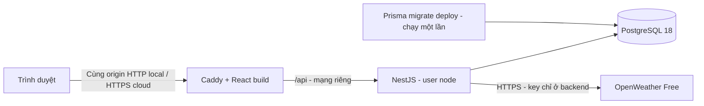

# Docker và triển khai

## Thiết kế đóng gói



Frontend build nhiều stage, chỉ copy `dist` vào Caddy. Backend runtime chỉ có dependency production và `dist`; stage migrate giữ Prisma CLI để chạy migration. `.dockerignore` loại `.env*`, `.local`, node_modules và file build khỏi context. Không có secret trong build args. Image base được khóa digest; cập nhật digest có chủ đích khi cập nhật bản vá và chạy lại test.

Thứ tự local: PostgreSQL healthy → migrate kết thúc mã 0 → backend ready → frontend. Có ba dịch vụ chạy lâu dài và một job migration. Volume PostgreSQL 18 mount `/var/lib/postgresql`; không dùng đường dẫn dành cho image cũ. Tài khoản runtime `weather_app` không phải superuser; tài khoản admin chỉ nằm trong container DB. Không publish cổng DB/backend ra host. Frontend mặc định chỉ bind loopback.

## Chạy Docker trên Windows PowerShell

Cần Docker Desktop với Linux Engine đang chạy. Lệnh `docker version` phải có Server; `docker compose version` phải hoạt động. Mở terminal tại thư mục repository:

```powershell
node scripts/init-docker-env.mjs
docker compose --env-file .env.docker config --quiet
docker compose --env-file .env.docker up -d --build --wait
docker compose --env-file .env.docker ps
```

Script tạo `.env.docker` với mật khẩu DB và JWT/CSRF riêng. Nếu `.env` local có OpenWeather key hợp lệ, script copy key sang file mới nhưng không in ra terminal. Nếu chưa có, điền `OPENWEATHER_API_KEY` vào `.env.docker`. Script từ chối ghi đè file đã tồn tại. Không thay mật khẩu DB trong file sau khi volume đã khởi tạo mà chưa thực hiện quy trình đổi mật khẩu ở database.

Mở **http://localhost:8080**. Phải dùng đúng origin này, không đổi sang `127.0.0.1:8080` khi thao tác tài khoản. Dữ liệu Docker độc lập với cluster local cổng 55432. `migrate` ở trạng thái Exited(0) là đúng; ba dịch vụ còn lại phải healthy.

```powershell
Invoke-RestMethod http://localhost:8080/api/v1/health/ready
node frontend/e2e/docker-smoke.mjs
docker compose --env-file .env.docker logs --tail 100 backend migrate
```

Smoke test cần Chrome và thư viện frontend đã cài (`npm ci --prefix frontend`). Nó đăng ký tài khoản ngẫu nhiên, gọi thời tiết thật, lưu favorite, reload, logout rồi xóa đúng tài khoản test trong Docker DB. Không chạy song song nhiều lượt hoặc quá 5 lượt đăng ký/giờ trên cùng backend. Dữ liệu thời tiết không được mock.

Lệnh vận hành:

```powershell
# Dừng container, giữ nguyên dữ liệu
docker compose --env-file .env.docker down
# Chạy lại và giữ volume
docker compose --env-file .env.docker up -d --wait
# Xem trạng thái migration hoặc chủ động áp dụng migration trước rollout
docker compose --env-file .env.docker run --rm migrate npm run migrate:status
docker compose --env-file .env.docker run --rm migrate
```

**Không dùng `down -v` để khắc phục lỗi:** tùy chọn đó xóa dữ liệu. `depends_on` chỉ giúp thứ tự khởi động, không thay thế theo dõi readiness/backup trong vận hành. Chính sách restart xử lý process thoát, không tự khởi động lại chỉ vì health check unhealthy.

## Kiểm tra production cookie qua HTTPS local

```powershell
docker compose --env-file .env.docker -f docker-compose.yml -f docker/compose.https-test.yml up -d --wait
try {
    $env:SMOKE_HTTPS = '1'
    node frontend/e2e/docker-smoke.mjs
} finally {
    Remove-Item Env:SMOKE_HTTPS -ErrorAction SilentlyContinue
}
# Trả lại cấu hình HTTP local bình thường
docker compose --env-file .env.docker up -d --wait
```

Caddy tạo chứng chỉ CA nội bộ cho localhost; test chấp nhận chứng chỉ này **chỉ cho localhost hardcode**. Không cài CA vào máy và không tắt kiểm tra TLS của ứng dụng backend. Kiểm tra xác nhận cookie `__Host-*`, Secure, HttpOnly, SameSite=Lax, HSTS/CSP và Swagger không mở trong production. Đây không phải xác minh chứng chỉ/domain public.

## Cloud: frontend/backend container + PostgreSQL managed

Phương án mặc định là một Linux VM chạy Caddy frontend và NestJS, cùng PostgreSQL managed trong vùng mạng gần VM. Một origin duy nhất giảm phức tạp cookie/CORS; chưa hỗ trợ tự động chia frontend/API sang hai origin khác nhau. Không cần đổi SameSite sang None hoặc lưu token vào localStorage.

1. Chuẩn bị VM, Docker Engine/Compose, domain và PostgreSQL managed 18 tương thích. Chi phí, vùng, backup/PITR và giới hạn kết nối cần xác nhận trong tài khoản nhà cung cấp; dự án không tạo hoặc mua dịch vụ tự động.
2. Tạo database `weather_app` và tài khoản sở hữu schema, không dùng tài khoản admin của provider làm runtime. Giới hạn truy cập DB tới VM qua private network hoặc allowlist IP. Dùng URL TLS do provider cấp và xác minh chứng chỉ; không dùng `rejectUnauthorized: false`. Nếu provider yêu cầu CA riêng, mount file CA read-only và cấu hình TLS theo hướng dẫn provider. URL mẫu dùng `sslmode=verify-full`.
3. Copy source đã review lên VM. Copy `docker/cloud.env.example` thành `.env.cloud` ngoài Git; điền DOMAIN không có scheme/path, DATABASE_URL và key. Tạo JWT/CSRF độc lập tối thiểu 43 ký tự, không dùng lại secret development. Giới hạn quyền đọc file (Linux `chmod 600 .env.cloud`). Không in `docker compose config` đầy đủ vì có thể lộ giá trị môi trường; dùng `config --quiet`.
4. Trỏ DNS A/AAAA của domain tới VM, chỉ giữ AAAA nếu IPv6 thực sự hoạt động. Mở inbound TCP 80/443 và SSH chỉ từ IP quản trị; không mở 3000/5432. Đảm bảo VM ra được PostgreSQL, OpenWeather và CA qua HTTPS.
5. Dùng manifest riêng, không ghép với Compose local:

```powershell
docker compose --env-file .env.cloud -f docker-compose.cloud.yml config --quiet
docker compose --env-file .env.cloud -f docker-compose.cloud.yml build
docker compose --env-file .env.cloud -f docker-compose.cloud.yml run --rm migrate
docker compose --env-file .env.cloud -f docker-compose.cloud.yml up -d --wait
```

Các lệnh Docker giống nhau trên shell Linux; chỉ lệnh thao tác file/biến môi trường khác. Caddy phục vụ React, reverse proxy `/api`, tự cấp/gia hạn HTTPS khi DNS và cổng đúng. Backend NODE_ENV=production, APP_ORIGIN=`https://DOMAIN`, cookie Secure host-only. Swagger chỉ bật trong development; dùng API contract trong docs khi production.

Caddy là proxy trực tiếp của client trong phương án này. Backend chỉ tin `172.30.77.10`, Caddy ghi lại X-Forwarded-For từ peer thực tế. Nếu thêm CDN/load balancer hoặc đổi subnet/IP proxy, cần thiết kế lại chuỗi proxy tin cậy và kiểm thử spoofing; không đặt trust proxy=true. Subnet `172.30.77.0/24` phải chưa được dùng trên host; Compose local/cloud không chạy đồng thời cùng subnet trên một host. Mặc định chưa bật CORS cross-origin, không dùng wildcard.

Manifest cloud đã kiểm tra cú pháp với placeholder; **chưa kết nối một PostgreSQL managed hoặc deploy domain thật**. Không có thông tin tài khoản cloud được cung cấp. Nếu dùng nền tảng container khác VM, cấu hình tương đương: frontend route `/api` tới backend private DNS, `API_UPSTREAM` khi cần; cổng app 3000, health `/api/v1/health/ready`, job migration một lần trước rollout, proxy IP cụ thể và HTTPS edge. Không áp dụng manifest VM nguyên trạng nếu topology khác.

## Sau khi triển khai

- Kiểm tra redirect HTTP→HTTPS, chứng chỉ hợp lệ, trang sâu `/dang-nhap`, API health và tài nguyên CSS/JS.
- Tạo tài khoản thử do mình quản lý: đăng ký/login/logout, CSRF thiếu/sai origin bị từ chối; kiểm tra cookie trong DevTools, không copy cookie vào issue.
- Tìm địa điểm thật, xem forecast, C/F, favorites/history qua đăng nhập lại; refresh đa tab; so sánh phân quyền A/B.
- Thiết lập uptime check cho readiness, theo dõi 5xx/latency, CPU/RAM, kết nối DB và quota OpenWeather. Không ghi request body xác thực hoặc query có API key vào log. Chưa tích hợp dịch vụ monitoring tự động.
- Giữ một backend instance ở quy mô portfolio. Cache và rate limit đang ở bộ nhớ mỗi process; trước khi scale nhiều replicas cần kho chia sẻ/ngân sách provider toàn cụm. Mỗi backend pool tối đa 5 kết nối; tính cả migration/backup khi chọn quota DB.

## Sao lưu và rollback

Docker local: dùng pg_dump custom format trong container rồi copy ra host, tránh redirect nhị phân qua PowerShell cũ:

```powershell
New-Item -ItemType Directory -Path .local/backups -Force
$backupName = 'weather-' + (Get-Date -Format yyyyMMdd-HHmmss) + '.dump'
docker compose --env-file .env.docker exec -T db pg_dump -U weather_app -d weather_app -Fc -f /tmp/weather.dump
if ($LASTEXITCODE -ne 0) { throw 'Backup thất bại' }
docker compose --env-file .env.docker cp db:/tmp/weather.dump ".local/backups/$backupName"
```

Backup chứa dữ liệu tài khoản, phải giữ ngoài Git và bảo vệ như dữ liệu thật. Với cloud, bật backup/PITR của provider và kiểm tra phục hồi định kỳ. Kiểm tra restore vào **database mới**, không ghi đè database đang dùng:

```powershell
# Dùng tên mới chưa tồn tại; chỉ tiếp tục khi createdb thành công.
docker compose --env-file .env.docker exec -T db createdb -U weather_admin -O weather_app weather_restore_check
if ($LASTEXITCODE -ne 0) { throw 'Database kiểm tra đã có hoặc không tạo được' }
docker compose --env-file .env.docker cp ".local/backups/$backupName" db:/tmp/restore.dump
docker compose --env-file .env.docker exec -T db pg_restore -U weather_app -d weather_restore_check --no-owner --exit-on-error /tmp/restore.dump
```

Trước release: backup, lưu commit/image ID cũ và review SQL migration. Ưu tiên migration additive/backward-compatible. Khi lỗi app, quay về image cũ **chỉ khi schema còn tương thích**; không tự revert database hoặc chạy reset. Nếu migration phá tương thích, dùng forward fix hoặc kế hoạch khôi phục snapshot có downtime và đối soát dữ liệu. Không hứa rollback không mất dữ liệu sau các thao tác ghi mới.

## Lỗi thường gặp

- Engine pipe không tồn tại: mở Docker Desktop, chờ Linux Engine; `docker version` phải có Server.
- Backend unhealthy: kiểm tra log và origin/secret, migrate exit code, DB readiness; không sửa DB URL thành admin để tránh lỗi quyền.
- Auth 403: đúng hostname/port, APP_ORIGIN, cookie và CSRF. Trong HTTP local không bật NODE_ENV=production.
- DB password không khớp sau sửa `.env.docker`: init script chỉ chạy khi volume rỗng. Khôi phục cấu hình đúng hoặc đổi mật khẩu DB có kế hoạch; không xóa volume.
- Network pool overlap: chọn subnet chưa dùng và cập nhật đồng bộ frontend static IP/TRUST_PROXY_IP; kiểm thử lại.
- Caddy cảnh báo `Unnecessary header_up X-Forwarded-For`: directive được giữ tường minh để xóa ảnh hưởng header client; validate vẫn đạt.
- 429 hoặc weather 503: tôn trọng Retry-After; kiểm tra key/gói/quota, không dùng dữ liệu giả để vượt nghiệm thu.

## Tài liệu chính thức đã đối chiếu

- [PostgreSQL 18 Docker: đường dẫn volume](https://docs.docker.com/guides/postgresql/).
- [Compose: thứ tự phụ thuộc và health check](https://docs.docker.com/compose/how-tos/startup-order/).
- [Prisma ORM 7: migrate deploy](https://www.prisma.io/docs/orm/v7/prisma-migrate/workflows/development-and-production). Dự án giữ Prisma 7.10.1; không dùng CLI Prisma 8 theo tài liệu latest.
- [Caddy automatic HTTPS](https://caddyserver.com/docs/automatic-https), [reverse proxy](https://caddyserver.com/docs/caddyfile/directives/reverse_proxy), [headers](https://caddyserver.com/docs/caddyfile/directives/header).
